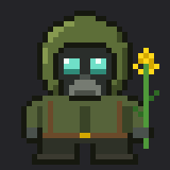

# Ripachok

A 32×32 pixel buddy who lives in the band above the Claude Code prompt: a little Zone stalker in a green hood and gas mask, holding a sprig of rapeseed (*ріпак*, hence the name).



## What he does

| When | He… |
| --- | --- |
| Claude is idle | breathes and blinks |
| Claude is working | paces back and forth above the prompt, one pixel per step |
| A turn finishes | waves the rapeseed with a heart for ~2.5 s |
| You hover him (desktop) | waves at you |
| ~90 s of quiet | falls asleep, Zs drifting up |

He's drawn in true pixels everywhere:

- **Desktop app (Code tab):** a crisp SVG at an exact integer scale (64×64 by default).
- **Terminal:** every art pixel is half a cell (`▀`/`▄` in 24-bit colour), so the 32×32 sprite takes 32 columns × 16 rows. Needs a truecolor terminal (Windows Terminal, iTerm2, kitty, Ghostty, WezTerm…). If the prompt area is shorter than 16 rows he politely stays hidden.

## Install

In Claude Code (terminal):

```
/plugin install ripachok --marketplace Somnx32/ripachok
```

Answer `y` to add the marketplace, then pick the **user** scope with Enter. He shows up right away and in every session after, including the desktop app's Code tab.

## Commands

```
/ripachok            show or hide him
/ripachok size <n>   desktop: CSS px per art pixel (1 = 32px, 2 = 64px)
/ripachok lane <n>   how far he paces while Claude works, in art pixels (40–400)
/ripachok sleep <s>  seconds idle before he dozes off (5–3600)
/ripachok reset      back to defaults
```

Tip: with 125% Windows display scaling, `/ripachok size 1.6` makes every art pixel exactly 2×2 screen pixels.

## Editing the art

The sprite lives as character grids in [`art/sprite.py`](art/sprite.py). After changing it:

```
cd art
python3 sprite.py                       # preview PNGs + sprite sheets
python3 gen_art.py ../hooks/art.ts      # regenerate the mod's art data
```

Then `claude plugin test .` from the repo root runs the tests.

## License

MIT
